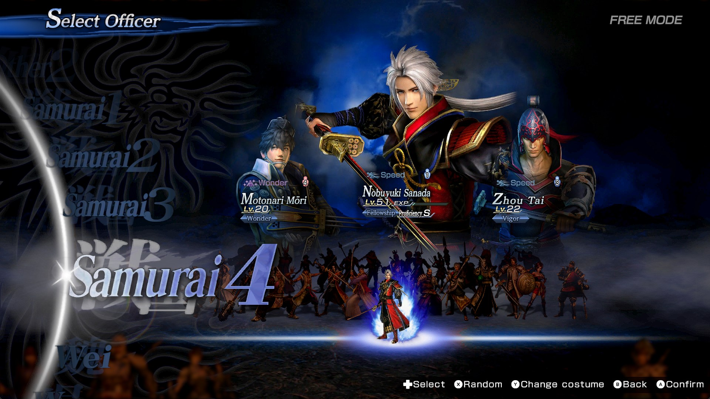
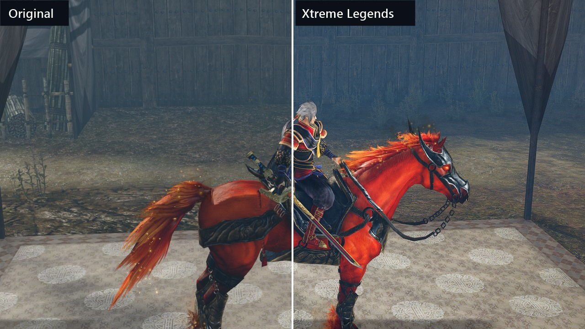
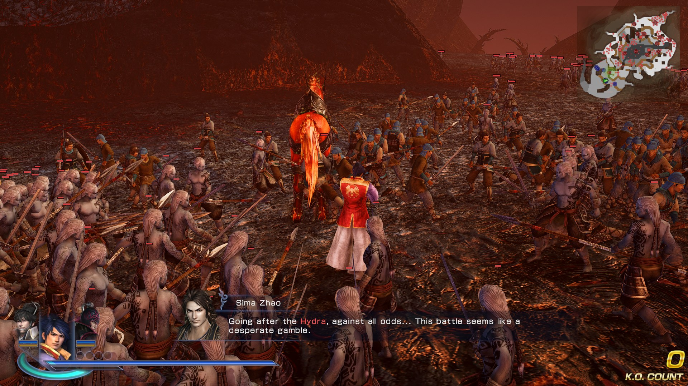
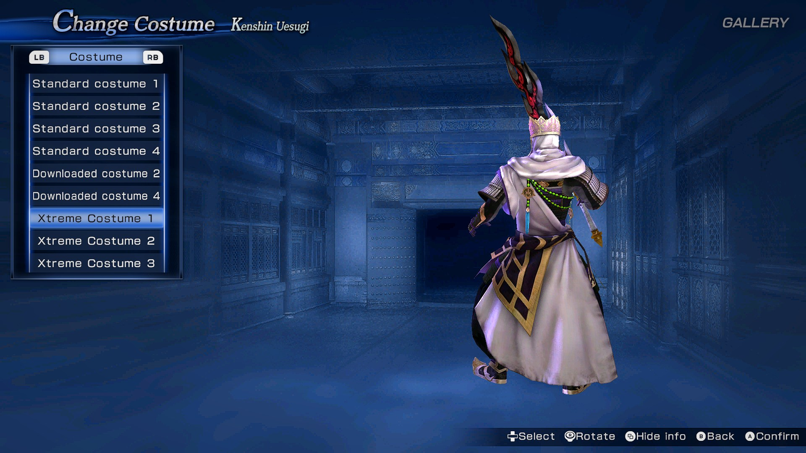
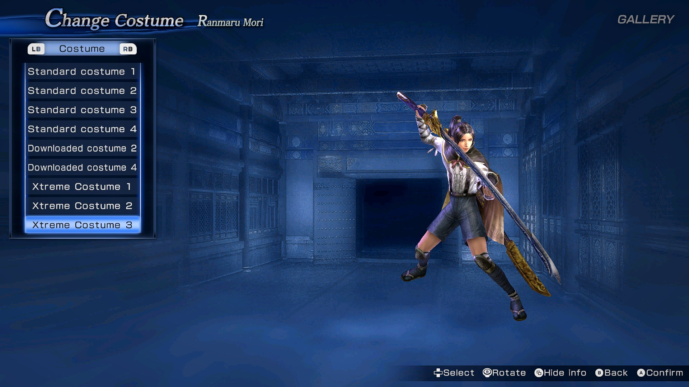
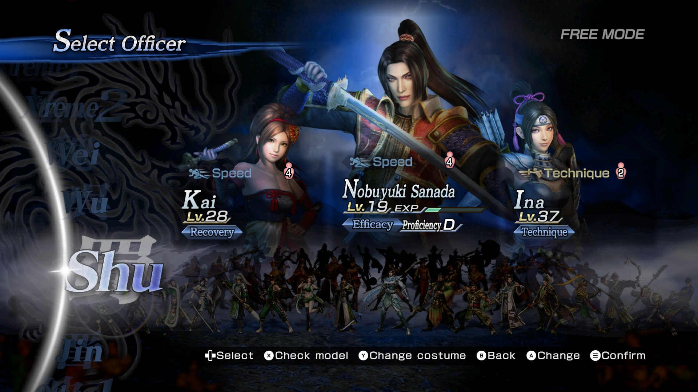
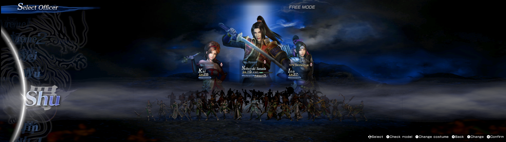

# Warriors Orochi 3 Ultimate Definitive Edition Xtreme Legends

[**View the project tracker**](https://ashimpure.github.io/WO3UDEXL/)

This project explores read-adding missing content from the original Definitive Edition release. Adding entirely new characters, costumes, improved graphics and menus, larger battles, and eventually new stages and new enemy types to Warriors Orochi 3 Ultimate Definitive Edition.

Progress bars on the tracker are very very broad estimates. [Suggest an update](https://github.com/ashimpure/WO3UDEXL/issues/new?template=tracker-update.yml).

## Community

- [Musou Warriors Discord](https://discord.com/invite/SpCw3vC)
- [Project discussion](https://discord.com/channels/606031682708963328/1555967493070393426)

## Screenshots

[Watch a 1,000-character battle](https://ashimpure.github.io/WO3UDEXL/assets/screenshots/crowd-1000.mp4)

Menu and ultrawide screenshots are from an earlier build, before Nobuyuki's own art was added.

  
  
  
  
  
  
  

